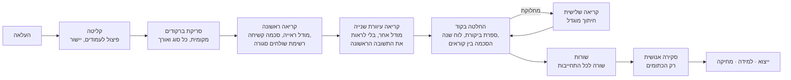

# Safe Line · שורה בטוחה

**מנוע שהופך טפסי התחייבות רפואיים — סרוקים, מצולמים, הפוכים, בכתב יד — לשורות מאומתות בגיליון.
כשהמנוע לא בטוח הוא אומר את זה, מסביר למה, ומראה בדיוק את הפיקסלים שקרא.**

> Open Source AI Hackathon 2026 · אתגר "מטפסי התחייבות לאקסל" של המעבדה המרכזית לנגיפים, משרד הבריאות
> צוות: אהובה, שירה

---

## תוכן עניינים

1. [הבעיה](#1-הבעיה)
2. [הפתרון בקצרה](#2-הפתרון-בקצרה)
3. [מה המערכת מחלצת](#3-מה-המערכת-מחלצת)
4. [חוויית המשתמש](#4-חוויית-המשתמש)
5. [איך המנוע עובד](#5-איך-המנוע-עובד)
6. [סולם הביטחון: ירוק, ענבר, כתום](#6-סולם-הביטחון-ירוק-ענבר-כתום)
7. [עקרונות התכנון](#7-עקרונות-התכנון)
8. [ארכיטקטורה](#8-ארכיטקטורה)
9. [שכבת הלמידה](#9-שכבת-הלמידה)
10. [פרטיות ואבטחה](#10-פרטיות-ואבטחה)
11. [הערכה ומדדים](#11-הערכה-ומדדים)
12. [טכנולוגיות](#12-טכנולוגיות)
13. [הרצה ופריסה](#13-הרצה-ופריסה)
14. [מבנה המאגר](#14-מבנה-המאגר)
15. [מסמכים נוספים](#15-מסמכים-נוספים)

---

## 1. הבעיה

המעבדה המרכזית לנגיפים מקבלת מדי יום עשרות דגימות. לכל דגימה מצורף **טופס התחייבות** — המסמך
שבו הגורם המממן (קופת חולים, בית חולים, מעבדה פרטית, צה"ל) מתחייב לשלם על הבדיקה.

הטפסים מגיעים מ-4 קופות, יותר מ-20 בתי חולים, מעבדות פרטיות ושירותי רפואה צבאיים, ואין שניים
שנראים אותו דבר: מודפסים, סרוקים, מצולמים בטלפון, הפוכים, בפקס, בכתב יד, או צילום מסך של מערכת
SAP של בית חולים. לבורנטית מקלידה את כל זה ידנית לגיליון — **בערך שעה ל-30 טפסים**, עם טעויות
שאף אחד לא שם לב אליהן.

טעות כזו אינה קוסמטית: מספר מרכזי שגוי מצמיד תוצאת בדיקה **לדגימה של מטופל אחר**.

## 2. הפתרון בקצרה

גוררים ערימת טפסים למסך. תוך כמה דקות מתקבלת טבלה: רוב התאים ירוקים (אומתו), ומעטים כתומים
(צריך עין אנושית). לחיצה על תא כתום מציגה את האזור המקורי בטופס, מוגדל, יחד עם הסיבה לספק
ואפשרויות לבחירה. בסוף — ייצוא ל-Excel, CSV או JSON.

העיקרון המנחה: **שדה ריק ומסומן עדיף על ניחוש.** המדד המוביל של הפרויקט הוא לא "אחוז דיוק" אלא
**טעות שקטה** — ערך שגוי שהמערכת *לא* סימנה. מערכת שמדייקת ב-95% ומסמנת את כל טעויותיה בטוחה;
מערכת שמדייקת ב-98% ומסתירה אותן מסוכנת.

התרחיש שאליו מכוונים: 30 טפסים → כ-4 דקות → אפס ערכים שגויים שלא סומנו.

## 3. מה המערכת מחלצת

שבעה שדות מכל טופס, כל אחד עם ערך, מקור, מיקום בעמוד, מועמדים חלופיים, ציון ורמת ביטחון:

| שדה | הערות |
|---|---|
| שם פרטי | בדוגמאות — בכתב יד; לעולם לא "מתקנים" איות |
| שם משפחה | כנ"ל |
| מספר תעודת זהות | מאומת בספרת ביקורת; אפסים מובילים מנורמלים |
| מספר מרכזי | המספר הפנימי של המעבדה לדגימה. **יכולים להיות כמה** — כולם נשמרים |
| תאריך קבלת הדגימה | מחותמת "התקבל" של המעבדה בלבד; תאריך לא קיים או עתידי נדחה |
| גורם שולח | נבחר **מרשימה סגורה** של 37 מוסדות, או "לא ברשימה". לעולם לא מומצא, ולעולם לא היעד |
| מספר התחייבות | פורמט שונה לכל מוסד (גם עם אותיות). **כמה התחייבויות = כמה שורות** |

**מה המערכת לא קוראת, בכוונה:** תוכן קליני — אבחנה, בדיקה מבוקשת, הערות רופא. אזורים אלה לא
נשלחים לשום ספק חיצוני.

## 4. חוויית המשתמש

ממשק בעברית, מימין לשמאל, בשישה מסכים:

| מסך | מה קורה בו |
|---|---|
| **כניסה** | קוד גישה |
| **העלאה** | גרירה של קובץ אחד או ערימה: PDF, PNG, JPG או ZIP |
| **עיבוד** | התקדמות חיה לכל עמוד (Server-Sent Events) ומונים |
| **סקירה** | הטבלה עצמה. כל תא צבוע לפי רמת הביטחון, עם אייקון וטקסט (לא רק צבע). לחיצה פותחת "עדשת ראיות": החיתוך המקורי מהעמוד, שרשרת הקריאות, הסיבה, ומועמדים לבחירה. עבודה מלאה מהמקלדת, ביטול פעולה, ויומן ביקורת לכל עריכה |
| **ייצוא** | Excel עם צבעים והערות בתאים, CSV, JSON |
| **לוח מדדים** | דיוק לפי שדה, טבלת ablation, עקומת למידה, עלות |

בנוסף, **מצב לחץ**: מריץ מחדש את אותם טפסים אחרי השחתה מכוונת (סיבוב, טשטוש, הסרת סימון צהוב)
כדי להראות שהמנוע ממשיך לעבוד ומסמן במקום לנחש.

## 5. איך המנוע עובד

**מודל ראייה קורא, קוד מחליט, אדם רק איפה שצריך** ([ADR-017](docs/decisions/ADR-017-vision-first.md)).



1. **קליטה** — בדיקת סוג קובץ אמיתי (magic bytes), מגבלות גודל, פיצול PDF לעמודים, יישור עמודים
   הפוכים.
2. **סריקת ברקודים** (מקומית, כשנייה לעמוד) — כל ברקוד שנקרא הוא "קורא" עצמאי נוסף.
3. **קריאה ראשונה** — העמוד כולו נשלח למודל ראייה (Gemini Flash) עם סכמת JSON קשיחה. הגורם השולח
   מוגדר בסכמה כרשימה סגורה, כך שהמודל יכול *לבחור* מוסד אך לא *להמציא* אחד. הפרומפט מכיל את
   הידע על הטפסים: שמות תוויות, מלכודות, היעד שאסור להחזיר, כלל חותמת הקבלה.
4. **קריאה עיוורת שנייה** — מודל אחר קורא שוב, **בלי לראות את התשובה הראשונה**. שתי קריאות שמסכימות
   הן שני עדים בלתי תלויים.
5. **החלטה בקוד** — הקוד, לא המודל, קובע את רמת הביטחון (סעיף 6). במחלוקת נשלח חיתוך מוגדל לקריאה
   שלישית; רוב של שניים מתוך שלושה מכריע, אחרת השדה נשאר כתום.
6. **שורות** — קיבוץ עמודים לטפסים, שורה לכל מספר התחייבות, כל המספרים המרכזיים נשמרים.
7. **סקירה, ייצוא, למידה ומחיקה** — אחרי אישור הלבורנטית המערכת לומדת *איפה* נמצאים השדות (סעיף 9),
   וכל התמונות והערכים נמחקים אחרי 30 דקות.

**חוסן:** אם ספק נופל או נגמרת מכסה, השרשרת עוברת למפתח הבא, למודל הבא, ולבסוף לספק אחר
(OpenRouter, Groq). עמוד שאף מודל חזק לא קרא עובר ל**מסלול מקומי מלא** (Tesseract, ברקודים,
TrOCR לספרות בכתב יד) ומסומן. ריצה לעולם לא נעצרת. כ-5–10 שניות לעמוד, עמודים במקביל.

## 6. סולם הביטחון: ירוק, ענבר, כתום

| רמה | מתי | תצוגה |
|---|---|---|
| **A** | ברקוד וקריאה של הטקסט המודפס מסכימים, וכל הכללים הקשיחים עוברים | ירוק · `אומת בברקוד` ✓ |
| **B** | שני קוראים בלתי תלויים מסכימים, וכל הכללים הקשיחים עוברים | ירוק · `שני קוראים הסכימו` ✓ |
| **C** | קורא אחד, מקור מודפס, ציון גבוה | ענבר · `נקרא פעם אחת` ◐ |
| **D** | כל השאר | כתום · `לא בטוח – בדקי` ⚠ + סיבה |

- שדות קריטיים (ת"ז, מספר מרכזי, תאריך, התחייבות) ירוקים **רק** ברמה A או B.
- כל שדה כתום נושא סיבה **מרשימה סגורה**: "שני הקוראים לא הסכימו", "ספרת הביקורת של ת"ז לא
  תקינה", "התאריך עתידי", "הגורם לא ברשימה הסגורה" ועוד.
- **המודל לעולם לא מדווח על הביטחון של עצמו** — בסכמה אין שדה כזה. ביטחון נגזר רק מהסכמה בין
  קוראים בלתי תלויים ומכללי אימות.
- מספר שמופיע בשני שדות שונים (למשל גם כת"ז וגם כמספר מרכזי) מסמן את שניהם — ברקוד מוכיח את
  הספרות, לא לאיזה שדה הן שייכות.

## 7. עקרונות התכנון

| עיקרון | משמעות |
|---|---|
| **לעולם לא לנחש** | ערך שלא ניתן לאמת נשאר ריק ומסומן. ריק ≠ שגיאה |
| **אין פורמטים קבועים** | שדה מזוהה לפי התווית שלידו, לא לפי אורך או צורה. בדוגמאות יש מספר התחייבות עם אות (`X132767`), אורכים 4–9, מספרים מרכזיים בלי ברקוד, ומעבדה בלי מספר התחייבות |
| **רק תקנים אמיתיים פוסלים** | שני כללים קשיחים בלבד: ספרת ביקורת של ת"ז ישראלית, ותאריך שקיים בלוח השנה ואינו עתידי. כל השאר רק משפיע על הציון |
| **הקוד מחליט, לא המודל** | כל תשובה של מודל עוברת אימות סכמה ואז נשקלת כמועמד נוסף |
| **API קודם, Excel אחר כך** | Excel הוא מתאם ייצוא אחד. חיבור עתידי ל-SAP/LIMS של המעבדה הוא מתאם חדש, לא שכתוב |
| **תצורה, לא קבועים** | כל סף ומזהה מודל נמצא ב-[config/models.yaml](config/models.yaml) או ב-`.env`, כדי שאפשר יהיה לכייל ולהחליף ספק בלי לגעת בקוד |
| **דיווח כן** | יעד לעולם לא מוצג כהישג. כל מספר מגיע עם החלוקה והתאריך שבהם נמדד |

## 8. ארכיטקטורה

**Hexagonal (Ports & Adapters).** ליבת המנוע — צינור העיבוד, הניקוד, האימות — היא Python טהור שלא
מייבא אף framework או SDK של ספק. כל דבר חיצוני (OCR, ברקודים, מודלי ראייה, אחסון, ייצוא, למידה,
שעון) נגיש דרך **port** (ממשק), ומומש ב-**adapter**. הכלל נאכף ב-CI על ידי
[scripts/check_layering.py](scripts/check_layering.py).

למה זה חשוב כאן: ספקים חינמיים לא יציבים (מכסות משתנות, מודלים יוצאים משימוש), אז "Gemini נפל
היום" צריך להיות שינוי תצורה ולא שינוי קוד; והמעבדה תרצה בסוף SAP ולא Excel.


| שכבה | אחריות | תיקייה |
|---|---|---|
| לקוחות | ממשק משתמש, כלי שורת פקודה | `frontend/`, `tools/`, `eval/` |
| API | אימות, הגבלות קצב, מחזור חיי עבודה, SSE, ייצוא | `backend/api/` |
| ליבה | צינור העיבוד, ניקוד, אימות, בניית שורות | `backend/core/` |
| Ports | ממשקים ומודלי נתונים | `backend/core/ports/` |
| Adapters | Tesseract, zxing, Gemini/OpenRouter/Groq, SQLite, xlsx/csv/json | `backend/adapters/` |
| Composition root | המקום היחיד שבונה מתאמים ומזריק אותם | `backend/container.py` |

**ה-API (`/v1`)** — העלאת מסמך או אצווה, מעקב אחר עבודה (כולל זרם התקדמות), תוצאות, תמונות וחיתוכים,
עריכה ובחירת מועמד, ביטול, אישור, יומן ביקורת, ייצוא, מחיקה מיידית, מצב לחץ, ומדדים. כל נתיב
דורש `X-API-Key`; העלאות דורשות גם קוד גישה ותומכות ב-`Idempotency-Key`. החוזה המלא:
[docs/openapi.json](docs/openapi.json).

פירוט מלא: [docs/ARCHITECTURE.md](docs/ARCHITECTURE.md).

## 9. שכבת הלמידה

**"לומדת איפה, לא מי."** אין fine-tuning — אין מספיק נתונים, וזה היה מחייב לשמור מידע אישי. במקום
זה, אחרי כל שורה שהלבורנטית מאשרת, נשמרים:

- **מיקום** השדה בעמוד (תיבה מנורמלת) ונוסח התווית שלידו;
- **צורה מופשטת** של הערך (`X132767` ← `A######`), לא הערך עצמו;
- **מילות מפתח** מכותרת המוסד.

כל כתיבה למאגר עוברת בדיקה שדוחה שמות, מספרי זהות, תאריכים, ערכים ותמונות. רמז משפיע על הניקוד רק
אחרי **שלושה** אישורים, ותווית או מוסד חדשים דורשים אישור מפורש. כל שינוי התנהגות ניתן למעקב
ולביטול.

## 10. פרטיות ואבטחה

טפסים רפואיים הם הקטגוריה הרגישה ביותר של מידע אישי.

- **אזורים קליניים** (אבחנה, בדיקה מבוקשת, הערות רופא) לעולם לא נשלחים — נאכף ב-assertion, לא
  במוסכמה.
- **מחיקה אוטומטית** של כל התמונות והערכים אחרי 30 דקות, ומחיקה מיידית לפי בקשה.
- **אין מידע אישי בלוגים** — הסינון הוא שלב קבוע ב-pipeline של הלוגים, אי אפשר "לשכוח" אותו.
- **הזרקת פרומפט לא רלוונטית**: טקסט בתמונה מוגדר כנתונים, התשובה חייבת לעמוד בסכמה קשיחה, למודל
  אין כלים ואין רשת, והאימות רץ אחרי התשובה.
- **`LOCAL_ONLY=true`** — המנוע רץ מקומית לחלוטין, אפס קריאות רשת (נבדק בטסט).
- **`CLOUD_REQUIRES_CONSENT=true`** — רק טפסי הדוגמה, או עבודות עם הסכמה מפורשת, מגיעים לענן.

> **חשוב:** במצב ברירת המחדל העמוד המלא נשלח לספק הענן. זה מקובל לטפסי הדוגמה המותאמים של האתגר
> בלבד — השכבה החינמית של Gemini עשויה להשתמש בקלט לאימון. פריסה אמיתית דורשת מפתח בתשלום (ללא
> אימון על הקלט) או `LOCAL_ONLY=true`, וכן אישור אבטחת מידע של משרד הבריאות. מידע רפואי הוא "מידע
> רגיש" לפי חוק הגנת הפרטיות. מאגר זה אינו ייעוץ משפטי.

פירוט: [docs/privacy.md](docs/privacy.md).

## 11. הערכה ומדדים

ההערכה הסופית נמדדת על **15 עמודים מוחזקים בצד** (held-out) מתוך 48 עמודי הדוגמה — עמודים שלא
שימשו לכיול, לכתיבת כללים, לכוונון פרומפטים או לבחירת קוראים.

| מדד | יעד | תוצאה |
|---|---|---|
| טעות שקטה (שגוי **ולא** מסומן) | ≤ 1% | טרם נמדד |
| Flag recall (שגויים שסומנו ÷ כל השגויים) | ≥ 95% | טרם נמדד |
| דיוק בשדות מודפסים | ≥ 98% | טרם נמדד |
| דיוק בשדות בכתב יד | ≥ 90% | טרם נמדד |
| 30 טפסים מקצה לקצה | פחות מ-4 דקות | טרם נמדד |
| עלות פיתוח | $0 | $0 |

הטבלה תמולא רק אחרי הרצת [eval/run_eval.py](eval/run_eval.py) על העמודים המוחזקים עם המנוע הנוכחי.

**בדיקה עצמית מול טבלת אמת:** [eval/selftest.py](eval/selftest.py) מריץ את המנוע על קובצי הדוגמה
ומשווה את השורות הסופיות (מה שמגיע לאקסל) לטבלת אמת, שדה אחרי שדה, ומחלק כל שדה לאחת מחמש קבוצות:
ירוק ונכון, **ירוק ושגוי (טעות שקטה - היעד הוא אפס)**, כתום ונכון, כתום ושגוי, ואמת לא ידועה.
ההרצה שולחת את העמודים למודל בענן ועולה כסף, ולכן היא לא מתבצעת בלי הדגל `--live`. לוגיקת הניקוד
נבדקת בלי מודל ב-[test_selftest.py](backend/tests/unit/test_selftest.py).
מדידה ראשונית על שלושה עמודי דוגמה (לא הערכה) מתועדת ב-[ADR-017](docs/decisions/ADR-017-vision-first.md).
מה עדיין לא עובד טוב — כתב יד עברי, אזורים בפריסות לא מוכרות, נגישות, ועוד:
[docs/limitations.md](docs/limitations.md).

## 12. טכנולוגיות

| תחום | כלים |
|---|---|
| מודלי ראייה (ענן, שכבה חינמית) | Gemini 3 Flash / 2.5 Flash, גיבוי OpenRouter ו-Groq |
| מנוע מקומי | Tesseract 5 (עברית + אנגלית), zxing-cpp, OpenCV headless, pypdfium2, TrOCR-small ONNX int8 (ספרות בכתב יד), rapidfuzz, Pydantic v2 |
| שרת | FastAPI, SQLite, openpyxl, structlog |
| ממשק | React, Vite, TypeScript, Tailwind, Radix |
| תשתית | Docker, Hugging Face Spaces, GitHub Actions |
| בדיקות | pytest (יחידה, אינטגרציה, אבטחה, חוסן), Vitest, Playwright, axe-core |

## 13. הרצה ופריסה

### דרישות מוקדמות

| רכיב | גרסה | הערות |
|---|---|---|
| Python | 3.12 ומעלה | |
| Node.js | 20 | לבניית הממשק |
| Tesseract OCR | 5, **עם חבילת עברית** | בלי עברית השרת מחזיר 503 ומסרב להעלאות. ב-Windows: [המתקין של UB Mannheim](https://github.com/UB-Mannheim/tesseract/wiki), לסמן Hebrew בזמן ההתקנה |
| מפתח Gemini | חינמי | [aistudio.google.com/apikey](https://aistudio.google.com/apikey) |

לא רוצים להתקין כלום מזה? דלגו ל[הרצה עם Docker](#הרצה-עם-docker) — הקונטיינר כולל הכל.

### שלב 1 — קובץ הגדרות

```powershell
cp .env.example .env
```

ממלאים ב-`.env`:

| משתנה | מה לשים |
|---|---|
| `GEMINI_API_KEYS` | המפתח מ-AI Studio (כמה מפתחות — מופרדים בפסיק) |
| `APP_ACCESS_CODE` | **סיסמת הכניסה למערכת** — בוחרים אותה בעצמכם, למשל `virology2026` |
| `API_KEY` | **להשאיר ריק** בהרצה מקומית. הממשק לא שולח מפתח כזה, וערך כאן יגרום ל-401 |
| `TESSERACT_CMD` | ב-Windows: `C:\Program Files\Tesseract-OCR\tesseract.exe` |

### שלב 2 — התקנה, בנייה והרצה

```powershell
pip install -r requirements.txt
cd frontend; npm ci; $env:VITE_API_BASE="/v1"; npx vite build; cd ..
python -m uvicorn backend.app:app --port 8000
```

### שלב 3 — כניסה

1. פותחים [http://localhost:8000](http://localhost:8000).
2. במסך הכניסה מקלידים את **קוד הגישה** — הערך של `APP_ACCESS_CODE` מ-`.env`.
3. מעלים טופס (PDF, PNG, JPG או ZIP) ועוקבים אחרי העיבוד עד מסך הסקירה.

בדיקת תקינות: [http://localhost:8000/v1/health](http://localhost:8000/v1/health) מחזיר `ok` כשהכל מוכן.

### הרצה עם Docker

```powershell
docker build -t safeline .
docker run -p 8000:8000 --env-file .env safeline
```

גם כאן — `APP_ACCESS_CODE` הוא קוד הכניסה, ו-`API_KEY` נשאר ריק. `TESSERACT_CMD` לא נדרש.

### פריסה לענן

Hugging Face Space חינמי, צעד אחר צעד: [docs/DEPLOY.md](docs/DEPLOY.md). קוד הגישה לסביבה הציבורית
נמסר לשופטים בתיאור ההגשה, לא במאגר.

### הגדרות נוספות

הרשימה המלאה, עם הסבר לכל משתנה: [.env.example](.env.example). החשובות:

| משתנה | תפקיד |
|---|---|
| `ENGINE_MODE` | `vision_first` (ברירת מחדל) או `cascade` (המסלול המקומי) |
| `LOCAL_ONLY` | `true` = אפס קריאות רשת |
| `JOB_TTL_MINUTES` | זמן עד מחיקה אוטומטית (ברירת מחדל 30) |

> **מכסה:** בשכבה החינמית של Gemini יש כ-20 בקשות ביום לכל מודל. 30 טפסים צורכים כ-40 בקשות.

## 14. מבנה המאגר

| נתיב | תוכן |
|---|---|
| `backend/core/` | ליבת המנוע: צינור העיבוד, ניקוד, אימות, בניית שורות |
| `backend/adapters/` | מימושים: OCR, ברקודים, ספקי ראייה, אחסון, ייצוא, למידה |
| `backend/api/` | נתיבי FastAPI |
| `backend/tests/` | טסטים: יחידה, אינטגרציה, אבטחה, חוסן |
| `frontend/` | ממשק הסקירה, React בעברית מימין לשמאל |
| `config/` | רשימת השולחים הסגורה, ספים ומודלים, פרומפטים בגרסאות |
| `eval/` | כלי ה-gold set, הגברת נתונים, מדדים, השוואת קוראים |
| `tools/`, `scripts/` | כלי עזר ובדיקות CI (שכבות, תיעוד, סודות, הגשה) |
| `docs/` | אפיון, ארכיטקטורה, החלטות, פרטיות, מגבלות, פריסה |
| `.kiro/` | כללי הפרויקט ונהלים (הרצת הערכה, הוספת מוסד, אימון גלאי) |
| `reference/` | קבצי ה-PDF של האתגר — **לא בגיט** |

## 15. מסמכים נוספים

| מסמך | מה יש בו |
|---|---|
| [docs/PLAN.md](docs/PLAN.md) | האפיון המלא: ידע על הדומיין, ארכיטקטורה, צינור העיבוד, ניקוד, אבטחה, עיצוב, הערכה, משימות |
| [docs/ARCHITECTURE.md](docs/ARCHITECTURE.md) | שכבות, ports, זרימת נתונים, מעבר בין ספקים |
| [docs/decisions/](docs/decisions/README.md) | רשומות החלטה (ADR) — למה כל דבר נעשה כפי שנעשה |
| [docs/privacy.md](docs/privacy.md) | מדיניות פרטיות מלאה |
| [docs/limitations.md](docs/limitations.md) | מה לא עובד, ורישיונות צד שלישי |
| [docs/demo_script.md](docs/demo_script.md) | תסריט ההדגמה |
| [docs/DEPLOY.md](docs/DEPLOY.md) | מדריך פריסה |

## רישיון

[MIT](LICENSE) לקוד שלנו. הודעות צד שלישי ב-[docs/limitations.md](docs/limitations.md).
